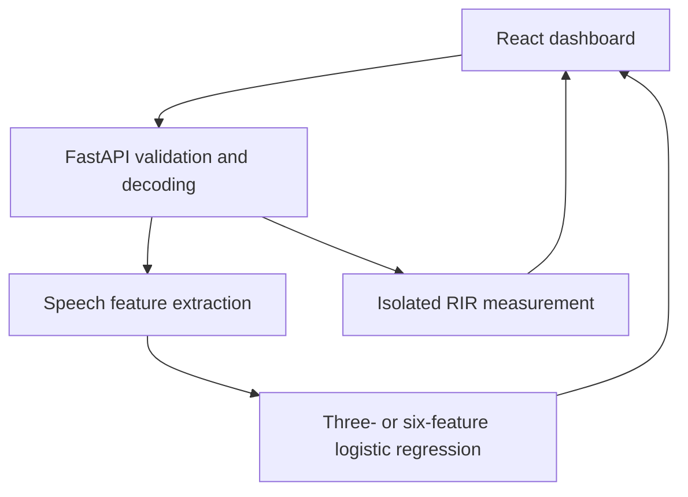

# Architecture and data lifetime

The speech and RIR branches accept different input assumptions. There is **no** edge that estimates RIR from speech or converts RIR metrics into an authenticity label. Offline training validates declared groups/hashes and produces trusted local artifacts; the API never trains from user uploads.

WaveSurfer previews the selected file in the browser. Inspection, RIR and prediction requests are multipart uploads; the backend uses temporary files and removes them in `finally` blocks. Heavy decoding, feature extraction and inference run in the thread pool. Prediction history stores only the latest 20 successful result objects in component memory; it is cleared on reload or explicitly by the user. The selected input may remain in browser memory until replaced/removed or the page closes.

Without a frontend directory configured, `/` is API JSON and Vite serves development UI separately through its proxy. With `ACOUSTICSPACE_FRONTEND_DIR` configured (including Docker), FastAPI serves the built UI/assets at the same origin as the API. There is no database or automatic deployment destination.
